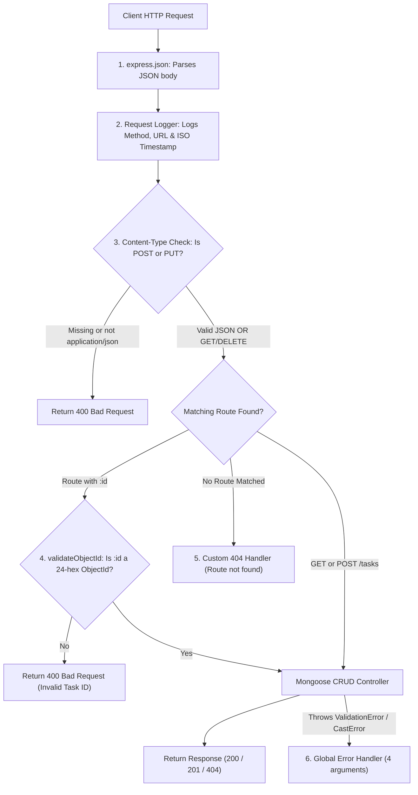

# Practical 5: MongoDB Integration and Schema Design with Mongoose

## 1. Objective
To extend the Task Management REST API developed in Practical 4 by integrating **MongoDB** using **Mongoose ODM**. This practical demonstrates transitioning from an in-memory storage array to persistent NoSQL database storage, designing a structured Mongoose schema with data types, defaults, validation rules, enums, and a pre-save hook, handling MongoDB ObjectIds in Express routes, and enforcing application-level data integrity and clean error handling.

---

## 2. Technologies Used
- **Node.js**: JavaScript runtime environment for backend logic.
- **Express.js**: Minimal web framework for routing and middleware pipelines.
- **MongoDB**: NoSQL document database for persistent data storage.
- **Mongoose (v8/v9)**: Object Data Modeling (ODM) library for MongoDB providing schema validation and hooks.
- **dotenv**: Environment variable management to keep configuration and credentials secure.
- **CommonJS**: Standard `require()` syntax matching Practical 4 architecture.

---

## 3. Project Folder Structure

```text
p4/
├── models/
│   └── Task.js           # Mongoose Schema, Model, and pre-save hook
├── node_modules/         # Dependencies (Express, Mongoose, dotenv)
├── .env                  # Local environment configuration (PORT, MONGO_URI - Git ignored)
├── .env.example          # Safe template configuration for submission/cloning
├── .gitignore            # Git exclusion rules (ignores .env and node_modules)
├── package.json          # Project metadata, dependencies, and npm scripts
├── package-lock.json     # Deterministic dependency lock file
├── README.md             # Complete practical documentation and Viva guide
├── server.js             # Main server, MongoDB connection, middleware, and CRUD routes
├── test-api.http         # Ready-to-run REST Client HTTP requests
└── test-runner.js        # Automated test suite executing all 15 test scenarios
```

---

## 4. Environment Variables Configuration

Sensitive configurations such as database connection strings and port numbers are managed using `dotenv`.

### Local `.env` File (Created locally, never committed to GitHub)
```env
PORT=5000
MONGO_URI=mongodb://127.0.0.1:27017/task_manager
```

### Safe Template `.env.example` (Committed to GitHub)
```env
# Server Configuration
PORT=5000

# MongoDB Connection URI (Local default or MongoDB Atlas connection string)
MONGO_URI=mongodb://127.0.0.1:27017/task_manager
# Atlas example: mongodb+srv://<username>:<password>@cluster0.mongodb.net/task_manager?retryWrites=true&w=majority
```

---

## 5. MongoDB Setup Guide

### Option A: Local MongoDB (Default & Recommended)
1. Ensure the **MongoDB Community Server** service is installed and running on your system.
   - On Windows, verify using PowerShell:
     ```powershell
     Get-Service -Name MongoDB
     ```
2. The default connection string is:
   ```text
   mongodb://127.0.0.1:27017/task_manager
   ```
3. MongoDB will automatically create the `task_manager` database and `tasks` collection upon saving the first document.

### Option B: MongoDB Atlas (Cloud Alternative)
If local MongoDB is not installed on your system:
1. Sign up for a free account at [MongoDB Atlas](https://www.mongodb.com/cloud/atlas).
2. Create a free shared cluster (M0 sandbox).
3. Under **Database Access**, create a database user (e.g., `admin`) and set a password.
4. Under **Network Access**, add IP address `0.0.0.0/0` (Allow access from anywhere).
5. Click **Connect** -> **Connect your application** -> Copy the connection string.
6. Paste it into your `.env` file:
   ```env
   PORT=5000
   MONGO_URI=mongodb+srv://admin:<your-password>@cluster0.mongodb.net/task_manager?retryWrites=true&w=majority
   ```

---

## 6. Installation & How to Run

### Step 1: Clone / Open Repository
Open terminal in the project directory:
```bash
cd "d:\5THSEM WDF\p4"
```

### Step 2: Install Dependencies
```bash
npm install
```

### Step 3: Start the Application
```bash
npm start
```
The server will connect to MongoDB first before accepting requests:
```text
Successfully connected to MongoDB at 127.0.0.1:27017/task_manager
Task Management API server running on http://localhost:5000
```
> **Note**: If MongoDB is not running, the application will display a clear error and cleanly exit instead of falling back to in-memory data.

### Step 4: Run the Automated Test Suite
To execute all 15 automated validation and CRUD tests:
```bash
npm test
```

---

## 7. Mongoose Task Schema & Pre-Save Hook

The Task schema is defined in [`models/Task.js`](file:///d:/5THSEM%20WDF/p4/models/Task.js):

| Field | Type | Validation / Constraints | Default Value | Description |
|---|---|---|---|---|
| `title` | `String` | `required: true`, `trim: true`, Custom non-empty validator | None | Task title; cannot be empty or whitespace |
| `description` | `String` | Optional | `""` (empty string) | Detailed explanation of task |
| `completed` | `Boolean` | Boolean | `false` | Status of completion |
| `priority` | `String` | Enum: `['low', 'medium', 'high']` | `"medium"` | Priority level of task |
| `createdAt` | `Date` | Date | `Date.now` | Creation timestamp |

### Application-Level Validation in Mongoose
Unlike relational databases where constraints are enforced by table schemas inside the database engine, **Mongoose enforces schema validation at the application level in Node.js** before documents are sent to MongoDB. If a document fails validation (e.g., missing title or priority = "urgent"), Mongoose aborts the operation and returns a structured `ValidationError` without making an unnecessary database write.

### Pre-Save Hook (`pre('save')`)
A pre-save hook is document middleware in Mongoose executed immediately before a document is persisted to MongoDB. In this project:
```javascript
taskSchema.pre('save', function (next) {
  if (this.title && typeof this.title === 'string') {
    this.title = this.title.trim();
  }
  if (typeof next === 'function') {
    next();
  }
});
```
This hook guarantees that any accidental leading or trailing whitespace is stripped before the document is stored.

---

## 8. Understanding MongoDB ObjectIds

In Practical 4, tasks used simple auto-incremented numeric IDs (`1`, `2`, `3`). In Practical 5, MongoDB uses **12-byte BSON ObjectIds** represented as **24-character hexadecimal strings** (e.g., `6adf36f0adcf4ff5723b0264`).

### Structure of an ObjectId:
- **4 bytes**: Unix timestamp of creation (seconds since epoch).
- **5 bytes**: Random unique process identifier.
- **3 bytes**: Incrementing counter.

### Why ObjectIds replace Numeric IDs:
1. **Globally Unique**: Safe for distributed and clustered database architectures without central coordination.
2. **Built-in Timestamp**: Creation time can be extracted directly from the ID.
3. **Validation**: Verified using `mongoose.Types.ObjectId.isValid(id)`. Any non-hexadecimal or wrong-length ID immediately returns `400 Bad Request`.

---

## 9. Middleware Execution Pipeline

Requests pass through a sequential pipeline in `server.js`:



### Pipeline Summary:
1. **`express.json()`**: Parses incoming JSON request payloads.
2. **Request Logger**: Logs method, URL, and timestamp (e.g., `POST /tasks - 2026-10-26T11:18:08.241Z`).
3. **Content-Type Validator**: Enforces `Content-Type: application/json` for `POST` and `PUT`.
4. **`validateObjectId` Middleware**: Verifies `:id` parameter format before Mongoose queries are made.
5. **Route Handlers**: Execute MongoDB operations via `Task.find()`, `Task.create()`, `Task.findById()`, `Task.findByIdAndUpdate()`, `Task.findByIdAndDelete()`.
6. **404 Catch-All Handler**: Returns structured JSON for unknown endpoints.
7. **Global Error Handler**: Four-argument middleware catching Mongoose `ValidationError`, `CastError`, duplicate-key errors, and server errors without leaking stack traces.

---

## 10. API Endpoints Reference

**Base URL**: `http://localhost:5000`

| Method | Endpoint | Description | Status Code | Required Headers |
|---|---|---|---|---|
| `GET` | `/tasks` | Retrieve all task documents | `200 OK` | `Accept: application/json` |
| `POST` | `/tasks` | Create a new task document | `201 Created` | `Content-Type: application/json` |
| `GET` | `/tasks/:id` | Retrieve single task by ObjectId | `200 OK` / `404` | `Accept: application/json` |
| `PUT` | `/tasks/:id` | Update task by ObjectId | `200 OK` / `404` | `Content-Type: application/json` |
| `DELETE` | `/tasks/:id` | Delete task by ObjectId | `200 OK` / `404` | None |

---

## 11. Request & Response Examples

### 1. GET /tasks
- **Request**: `GET http://localhost:5000/tasks`
- **Response (200 OK)**:
```json
[
  {
    "_id": "6adf380cbb73e2db400d2700",
    "title": "Complete Practical 5",
    "description": "Integrate MongoDB with Express and Mongoose",
    "completed": false,
    "priority": "high",
    "createdAt": "2026-10-26T11:22:52.290Z"
  }
]
```

### 2. POST /tasks (Successful Creation)
- **Request**: `POST http://localhost:5000/tasks`
- **Header**: `Content-Type: application/json`
- **Body**:
```json
{
  "title": "Complete Practical 5",
  "description": "Integrate MongoDB with Express",
  "completed": false,
  "priority": "high"
}
```
- **Response (201 Created)**:
```json
{
  "_id": "6adf380cbb73e2db400d2700",
  "title": "Complete Practical 5",
  "description": "Integrate MongoDB with Express",
  "completed": false,
  "priority": "high",
  "createdAt": "2026-10-26T11:22:52.290Z"
}
```

### 3. POST /tasks with Defaults (Omitted completed and priority)
- **Request**: `POST http://localhost:5000/tasks`
- **Body**:
```json
{
  "title": "Task with defaults"
}
```
- **Response (201 Created)**:
```json
{
  "_id": "6adf380cbb73e2db400d2705",
  "title": "Task with defaults",
  "description": "",
  "completed": false,
  "priority": "medium",
  "createdAt": "2026-10-26T11:23:10.150Z"
}
```

### 4. POST /tasks (Validation Failure - Missing / Blank Title)
- **Request**: `POST http://localhost:5000/tasks`
- **Body**:
```json
{
  "title": "   ",
  "description": "Whitespace title"
}
```
- **Response (400 Bad Request)**:
```json
{
  "error": "Validation failed",
  "details": [
    "Path `title` is required."
  ]
}
```

### 5. POST /tasks (Validation Failure - Invalid Priority Enum)
- **Request**: `POST http://localhost:5000/tasks`
- **Body**:
```json
{
  "title": "Invalid Priority Task",
  "priority": "urgent"
}
```
- **Response (400 Bad Request)**:
```json
{
  "error": "Validation failed",
  "details": [
    "`urgent` is not a valid priority. Allowed values are: low, medium, high."
  ]
}
```

### 6. PUT /tasks/:id (Successful Update)
- **Request**: `PUT http://localhost:5000/tasks/6adf380cbb73e2db400d2700`
- **Header**: `Content-Type: application/json`
- **Body**:
```json
{
  "completed": true,
  "priority": "low"
}
```
- **Response (200 OK)**:
```json
{
  "_id": "6adf380cbb73e2db400d2700",
  "title": "Complete Practical 5",
  "description": "Integrate MongoDB with Express",
  "completed": true,
  "priority": "low",
  "createdAt": "2026-10-26T11:22:52.290Z"
}
```

### 7. PUT /tasks/:id (Malformed ObjectId)
- **Request**: `PUT http://localhost:5000/tasks/invalid-id`
- **Response (400 Bad Request)**:
```json
{
  "error": "Invalid Task ID",
  "message": "The provided ID 'invalid-id' is not a valid MongoDB ObjectId"
}
```

### 8. GET or PUT /tasks/:id (Nonexistent Valid ObjectId)
- **Request**: `GET http://localhost:5000/tasks/507f1f77bcf86cd799439011`
- **Response (404 Not Found)**:
```json
{
  "error": "Task Not Found",
  "message": "Task with ID 507f1f77bcf86cd799439011 does not exist"
}
```

### 9. DELETE /tasks/:id (Successful Deletion)
- **Request**: `DELETE http://localhost:5000/tasks/6adf380cbb73e2db400d2700`
- **Response (200 OK)**:
```json
{
  "message": "Task deleted successfully",
  "task": {
    "_id": "6adf380cbb73e2db400d2700",
    "title": "Complete Practical 5",
    "description": "Integrate MongoDB with Express",
    "completed": true,
    "priority": "low",
    "createdAt": "2026-10-26T11:22:52.290Z"
  }
}
```

---

## 12. How to Verify Database Persistence

### Verification Steps:
1. **Create a task** using `POST /tasks`. Note the generated `_id`.
2. **Verify via GET**: Fetch `GET /tasks` to see the document.
3. **Stop the Node.js server**: Press `Ctrl + C` in the server terminal.
4. **Restart the server**: Run `npm start`.
5. **Re-query `GET /tasks`**: The task remains intact in the response!

### Inspecting via MongoDB Shell (`mongosh`):
Open your terminal and run:
```bash
mongosh task_manager
```
Inside the shell:
```javascript
db.tasks.find().pretty()
```

### Inspecting via MongoDB Compass (GUI):
1. Open **MongoDB Compass**.
2. Connect to URI: `mongodb://127.0.0.1:27017`.
3. In the left sidebar, click on the **`task_manager`** database.
4. Click on the **`tasks`** collection.
5. You can view, search, edit, or delete all stored task documents visually in real time.

---

## 13. Troubleshooting Common Issues

| Error Message | Cause | Solution |
|---|---|---|
| `Failed to connect to MongoDB: connect ECONNREFUSED 127.0.0.1:27017` | Local MongoDB service is stopped. | Start MongoDB service (`net start MongoDB` or Windows Services). |
| `Invalid Task ID: The provided ID is not a valid MongoDB ObjectId` | Request URL contains a numeric or string ID instead of a 24-character hex ObjectId. | Use the `_id` string returned by `POST /tasks` or `GET /tasks`. |
| `Validation failed: Path title is required` | Client submitted a POST/PUT request without `title` or with blank spaces. | Provide a non-empty string for `title`. |
| `Validation failed: urgent is not a valid priority` | Client provided a value outside enum `['low', 'medium', 'high']`. | Use only `low`, `medium`, or `high`. |
| `Invalid Content-Type: Content-Type must be application/json` | Client forgot `Content-Type: application/json` header in POST/PUT. | Add header in Postman / REST Client. |

---

## 14. Key Practical Questions & Answers

### Question 1: What is the difference between SQL (Relational) and NoSQL (MongoDB) databases?
> **Answer**:
> - **SQL Databases** (such as MySQL, PostgreSQL) are relational, table-based databases with rigid, predefined schemas where data is stored in rows and columns and relations are managed through foreign keys and joins.
> - **NoSQL Databases** (such as MongoDB) are document-oriented databases that store data in flexible, JSON-like BSON documents. They support dynamic schemas, scale horizontally with ease, and are well-suited for hierarchical or rapidly-changing data structures.

### Question 2: What is Mongoose, and why do we define Schemas and Models?
> **Answer**:
> - **Mongoose** is an Object Data Modeling (ODM) library for MongoDB and Node.js.
> - While native MongoDB is schema-less, **Schemas** in Mongoose define the structure, data types, default values, and validation rules for documents at the application layer.
> - A **Model** is a compiled wrapper constructed from a schema that provides an interface to query, create, update, and delete documents in the underlying MongoDB collection (e.g. `Task.find()`, `Task.create()`).

### Question 3: What is the purpose of Mongoose middleware (hooks) like `pre('save')`?
> **Answer**:
> - Mongoose middleware (hooks) are functions that execute automatically at specified stages of the document lifecycle (such as before or after saving, validating, or removing a document).
> - The `pre('save')` hook allows developers to perform operations such as trimming strings, hashing passwords, or calculating derived values automatically before the document is persisted to the database.

---

## 15. College Viva Questions & Answers

### 1. What is an ODM, and how does it differ from an ORM?
> **Answer**: ODM stands for **Object Data Modeling** (used for document/NoSQL databases like MongoDB and Mongoose). ORM stands for **Object Relational Mapping** (used for relational SQL databases like Sequelize and PostgreSQL/MySQL). Both map programming language objects to database records.

### 2. How does Mongoose prevent invalid data from being saved?
> **Answer**: Mongoose enforces **application-level schema validation**. Before executing an `insert` or `update` command, Mongoose checks document fields against the defined schema constraints (such as `required`, `enum`, `minlength`, or custom validators). If any constraint fails, it throws a `ValidationError` and prevents database execution.

### 3. Why is `runValidators: true` required in `findByIdAndUpdate()`?
> **Answer**: By default, Mongoose update operations (like `findOneAndUpdate` and `findByIdAndUpdate`) bypass schema validators to optimize performance. Passing `{ runValidators: true }` instructs Mongoose to validate the update payload against the schema before applying the update.

### 4. What is a MongoDB ObjectId and how many bytes is it?
> **Answer**: An ObjectId is a 12-byte (24-character hexadecimal) unique identifier generated by MongoDB for every document in a collection. It consists of a 4-byte timestamp, a 5-byte random value, and a 3-byte incrementing counter.

### 5. Why should a server not start accepting requests before MongoDB connects?
> **Answer**: If the HTTP server starts listening before the database connection is established, incoming client requests will fail, timeout, or attempt to query an uninitialized connection. Awaiting `mongoose.connect()` guarantees that all dependencies are ready before handling traffic.

### 6. What is the difference between `new Task(data).save()` and `Task.create(data)`?
> **Answer**: `new Task(data).save()` explicitly creates a document instance first and then saves it, giving direct access to document methods and pre-save hooks. `Task.create(data)` is a convenience method that combines instantiation and saving in a single call.

### 7. What does the `trim: true` schema option do?
> **Answer**: `trim: true` automatically removes leading and trailing whitespace from string values before they are validated and saved.

### 8. Why do we keep `.env` in `.gitignore`?
> **Answer**: `.env` files contain environment-specific configurations and sensitive credentials (such as database passwords and API keys). Committing `.env` to GitHub exposes secrets to the public, risking security breaches. A safe template `.env.example` is committed instead.
