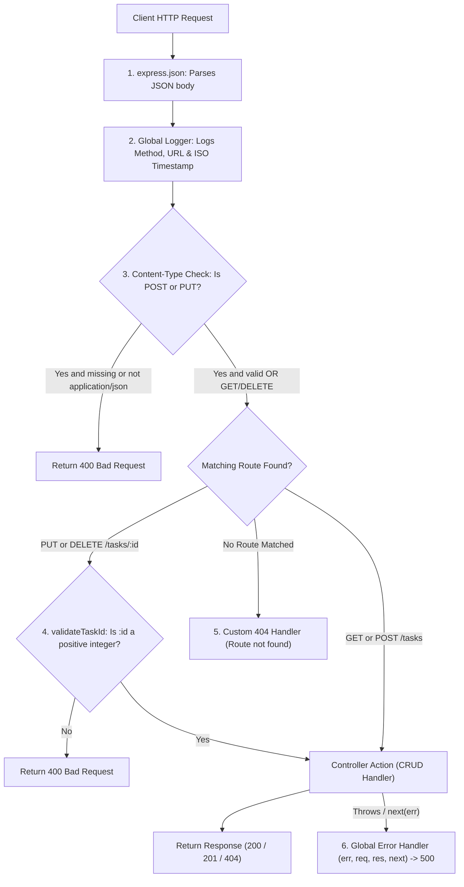

# Practical 4: Building a RESTful API with Node.js and Express

## 1. Objective
To design and build a RESTful Task Management API using **Node.js** and **Express.js**, implement the four core CRUD operations (Create, Read, Update, Delete) using an in-memory data store, establish a clean middleware execution pipeline with request validation and logging, and implement robust error-handling mechanisms.

---

## 2. Project Overview & Folder Structure

```text
task-manager-api/
├── node_modules/         # Third-party dependencies (Express)
├── .gitignore            # Git exclusion file (node_modules, logs, .env)
├── package.json          # Project configuration, scripts, and dependencies
├── server.js             # Main server, middleware pipeline, and CRUD routes
├── test-api.http         # VS Code REST Client test requests
├── test-runner.js        # Automated verification script for 10 test scenarios
└── README.md             # Documentation, API reference, and Viva Q&A
```

---

## 3. Installation & Getting Started

### Prerequisites
- **Node.js** (v18 or higher recommended; verified on Node v24)
- **npm** (v9 or higher; verified on npm v11)

### Step 1: Install Dependencies
Open your terminal in the project directory and run:
```bash
npm install
```

### Step 2: Start the Server
Start the Express server on port `5000`:
```bash
npm start
```

You should see:
```text
Task Management API server running on http://localhost:5000
```

### Step 3: Run Automated Test Suite
To execute the automated 10-endpoint test verification:
```bash
npm run test:api
```

---

## 4. Middleware Execution Lifecycle

Express processes requests through a sequential pipeline from top to bottom. In this project, requests flow through the following stages:



### Pipeline Breakdown:
1. **`express.json()`**: Reads incoming payload streams and parses JSON into `req.body`.
2. **Global Logging Middleware**: Logs `METHOD URL - TIMESTAMP` (e.g., `GET /tasks - 2026-10-21T11:04:29.535Z`).
3. **Content-Type Validation**: Ensures `POST` and `PUT` requests carry `Content-Type: application/json`.
4. **Task ID Validation (`validateTaskId`)**: Route-specific middleware verifying that `:id` is a positive integer before hitting controller logic.
5. **Route Handlers**: Execute business logic against the in-memory array.
6. **404 Catch-All Handler**: Returns structured JSON for unknown routes.
7. **Global Error Middleware**: Catches unhandled errors or malformed JSON payloads and returns clean HTTP responses.

---

## 5. API Endpoints Documentation

**Base URL**: `http://localhost:5000`

| Method | Endpoint | Description | Status Code | Required Headers |
|---|---|---|---|---|
| `GET` | `/tasks` | Retrieve all tasks | `200 OK` | None |
| `POST` | `/tasks` | Create a new task | `201 Created` | `Content-Type: application/json` |
| `PUT` | `/tasks/:id` | Update an existing task | `200 OK` | `Content-Type: application/json` |
| `DELETE` | `/tasks/:id` | Delete a task | `200 OK` | None |

---

## 6. Request & Response Examples

### A. GET /tasks
- **Method**: `GET`
- **URL**: `http://localhost:5000/tasks`
- **Response**: `200 OK`
```json
[
  {
    "id": 1,
    "title": "Complete Practical 4",
    "description": "Build RESTful API using Express",
    "completed": false
  },
  {
    "id": 2,
    "title": "Prepare for Viva Examination",
    "description": "Review REST concepts and Express middleware lifecycle",
    "completed": false
  }
]
```

### B. POST /tasks
- **Method**: `POST`
- **URL**: `http://localhost:5000/tasks`
- **Headers**: `Content-Type: application/json`
- **Request Body**:
```json
{
  "title": "Submit Practical 4 Assignment",
  "description": "Upload code repository and report",
  "completed": false
}
```
- **Response**: `201 Created`
```json
{
  "id": 3,
  "title": "Submit Practical 4 Assignment",
  "description": "Upload code repository and report",
  "completed": false
}
```

### C. PUT /tasks/:id
- **Method**: `PUT`
- **URL**: `http://localhost:5000/tasks/1`
- **Headers**: `Content-Type: application/json`
- **Request Body**:
```json
{
  "completed": true
}
```
- **Response**: `200 OK`
```json
{
  "id": 1,
  "title": "Complete Practical 4",
  "description": "Build RESTful API using Express",
  "completed": true
}
```

### D. DELETE /tasks/:id
- **Method**: `DELETE`
- **URL**: `http://localhost:5000/tasks/2`
- **Response**: `200 OK`
```json
{
  "message": "Task deleted successfully",
  "task": {
    "id": 2,
    "title": "Prepare for Viva Examination",
    "description": "Review REST concepts and Express middleware lifecycle",
    "completed": false
  }
}
```

---

## 7. Testing Instructions

### Option 1: VS Code REST Client Extension
1. Install the **REST Client** extension in VS Code.
2. Open [test-api.http](file:///d:/5THSEM%20WDF/p4/test-api.http).
3. Click **"Send Request"** above any test case.

### Option 2: Postman Instructions
1. Open Postman and create a new collection called **"Practical 4 Tasks"**.
2. **GET /tasks**:
   - Method: `GET`, URL: `http://localhost:5000/tasks`. Click **Send**.
3. **POST /tasks**:
   - Method: `POST`, URL: `http://localhost:5000/tasks`.
   - Go to **Headers** tab: Verify `Content-Type: application/json`.
   - Go to **Body** tab: Choose **raw** -> **JSON**. Enter:
     ```json
     { "title": "Postman Test Task", "description": "Testing from Postman", "completed": false }
     ```
   - Click **Send** (verify status `201 Created`).
4. **PUT /tasks/1**:
   - Method: `PUT`, URL: `http://localhost:5000/tasks/1`.
   - Body: `raw` -> `JSON`: `{ "completed": true }`. Click **Send** (`200 OK`).
5. **DELETE /tasks/1**:
   - Method: `DELETE`, URL: `http://localhost:5000/tasks/1`. Click **Send** (`200 OK`).
6. **Error Case Testing**:
   - Try `PUT /tasks/abc` -> returns `400 Bad Request`.
   - Try `GET /invalid-url` -> returns `404 Not Found`.

### Option 3: Automated Script
Run:
```bash
npm run test:api
```
All 10 test scenarios execute against a live server instance and verify response codes.

---

## 8. Common Errors & Troubleshooting

1. **`EADDRINUSE: address already in use :::5000`**:
   - Another process or server is running on port 5000.
   - Kill the existing process or run on a custom port: `PORT=5002 npm start`.
2. **`400 Invalid Content-Type`**:
   - Ensure you added `Content-Type: application/json` in your request headers when making `POST` or `PUT` requests.
3. **`400 Validation Error: Title is required`**:
   - Check your JSON body. The `title` field must be present and cannot be an empty string.
4. **`404 Route not found`**:
   - Double-check the URL path. Endpoint names are case-sensitive (`/tasks`, not `/Tasks`).

---

## 9. Practical Viva Questions & Simple Answers

### 1. What is REST?
> **Answer**: REST stands for **Representational State Transfer**. It is an architectural style for designing networked web APIs that uses standard HTTP methods (`GET`, `POST`, `PUT`, `DELETE`) to perform operations on resources identified by URLs.

### 2. What is Express.js?
> **Answer**: Express.js is a minimal, fast, and flexible web application framework for Node.js. It simplifies building web servers and APIs by providing routing, middleware support, and HTTP utility methods.

### 3. What is middleware in Express?
> **Answer**: Middleware functions are functions that have access to the request object (`req`), response object (`res`), and the `next` function in the application’s request-response cycle. They can execute code, modify `req` or `res`, end the cycle, or call `next()` to pass control forward.

### 4. What is the difference between `app.use()` and route-specific middleware?
> **Answer**: 
> - `app.use()` registers **global middleware** that executes for all incoming requests (or for all requests under a path prefix).
> - **Route-specific middleware** is passed directly inside an individual route definition (e.g. `app.put('/tasks/:id', validateTaskId, handler)`) and runs only for that specific endpoint and method.

### 5. Why must error-handling middleware be placed last?
> **Answer**: Express runs middleware sequentially. The error-handling middleware takes 4 arguments `(err, req, res, next)`. It must be placed after all routes so that any error passed via `next(err)` anywhere upstream bubbles down to it. If placed first, normal routes would not have executed yet.

### 6. What does `next()` do?
> **Answer**: `next()` is a callback function that passes control to the next middleware function in the execution pipeline. If `next()` is not called and a response is not sent, the client request will hang indefinitely. If called with an argument like `next(err)`, it skips normal middleware and jumps straight to the error-handling middleware.

### 7. What is the difference between GET, POST, PUT, and DELETE?
> **Answer**:
> - **`GET`**: Retrieves data from the server without modifying server state (Safe and Idempotent).
> - **`POST`**: Submits new data to the server to create a new resource.
> - **`PUT`**: Updates or replaces an existing resource by its identifier (Idempotent).
> - **`DELETE`**: Removes the specified resource from the server.

### 8. Why do we use `express.json()`?
> **Answer**: By default, Node.js receives HTTP request bodies as raw binary data streams. `express.json()` reads and parses incoming requests with `application/json` Content-Type into a usable JavaScript object attached to `req.body`.

### 9. Why should raw error stack traces not be sent to clients?
> **Answer**: Sending stack traces exposes sensitive server implementation details, directory structures, third-party libraries, and potential vulnerabilities to attackers. In production, clients should receive a safe, generic message (`Internal Server Error`), while full stack traces are logged securely on the server.

### 10. What is the difference between HTTP 200 and HTTP 201?
> **Answer**:
> - **`200 OK`**: Indicates that the request succeeded (used for successful `GET`, `PUT`, or `DELETE` requests).
> - **`201 Created`**: Specifically indicates that the request succeeded and resulted in a **new resource** being created on the server (used for successful `POST` requests).

### 11. What is an in-memory array, and what happens to tasks after restarting the server?
> **Answer**: An in-memory array is stored in the system's RAM during the Node.js process runtime. Because the data is not persisted to a database or disk file, all added, modified, or deleted tasks will reset to the default initial sample tasks whenever the server restarts.

### 12. Why is a 404 handler needed?
> **Answer**: A custom 404 handler intercepts requests made to endpoints or paths that do not exist in the routing table. Instead of returning raw HTML or an unformatted browser error, it provides a consistent, structured JSON error response informing the client that the requested resource was not found.
